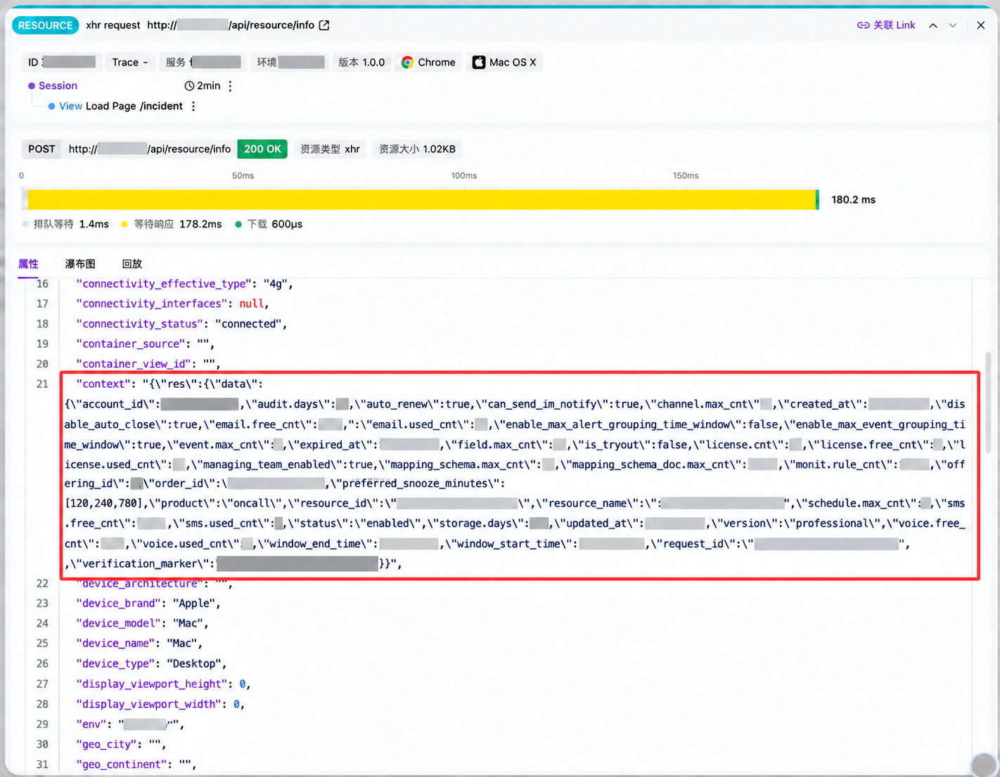

After [integrating the SDK](/en/rum/sdk/web/sdk-integration), configure views, context, sampling, and tracing as needed. Merge the initialization examples below into your existing `flashcatRum.init()` configuration.

## Override default RUM view names

RUM automatically creates views on page visits and SPA URL changes, normalizing path segments containing numbers to `?`. For example, `/dashboard/1234` and `/dashboard/9a` both use `/dashboard/?`. Enable manual tracking to define route boundaries yourself; use `setViewName()` if you only need to rename a view.

### Configure manual view tracking

<Steps>
<Step title="Enable Manual Tracking">
Set `trackViewsManually` to `true` during initialization:

```javascript rum-init.js
import { flashcatRum } from "@flashcatcloud/browser-rum";

flashcatRum.init({
  applicationId: "<YOUR_APPLICATION_ID>",
  clientToken: "<YOUR_CLIENT_TOKEN>",
  trackViewsManually: true
});
```
</Step>

<Step title="Call startView Method">
Call the `startView` method on each new page or route change:

```javascript
flashcatRum.startView({
  name: "checkout",
  service: "purchase",
  version: "1.2.3",
  context: {
    payment: "Done"
  }
});
```
</Step>
</Steps>

| `startView` option | Description |
| --- | --- |
| `name` | View name; defaults to the page URL path |
| `service` | Service name; inherits the application's service configuration |
| `version` | Application version; inherits the application's version configuration |
| `context` | Context attached to the view and its child events |

### React Router integration

<Accordion title="React Router v6 Example">

```javascript RumTracker.jsx
import { matchRoutes, useLocation } from "react-router-dom";
import { routes } from "path/to/routes";
import { flashcatRum } from "@flashcatcloud/browser-rum";
import { useEffect } from "react";

export default function App() {
  let location = useLocation();

  useEffect(() => {
    const routeMatches = matchRoutes(routes, location.pathname);
    const viewName = routeMatches && computeViewName(routeMatches);
    if (viewName) {
      flashcatRum.startView({ name: viewName });
    }
  }, [location.pathname]);

  // ...
}

function computeViewName(routeMatches) {
  let viewName = "";
  for (let index = 0; index < routeMatches.length; index++) {
    const routeMatch = routeMatches[index];
    const path = routeMatch.route.path;
    if (!path) continue;

    if (path.startsWith("/")) {
      viewName = path;
    } else {
      viewName += viewName.endsWith("/") ? path : `/${path}`;
    }
  }
  return viewName || "/";
}
```

</Accordion>

### Set view name

Use the `setViewName` method to update the current view's name without starting a new view:

```javascript
flashcatRum.setViewName("Checkout");
```

## Control initial view Web Vitals Collection

`trackWebVitals` defaults to `true`, collecting FCP, LCP, FID, and loading time on the initial load view. These values can be inflated for prerendered pages, background tabs, or pages loaded early by a host. Set the option to `false` for those cases. Resources, long tasks, actions, errors, and later view events are unaffected.

```javascript rum-init.js
import { flashcatRum } from "@flashcatcloud/browser-rum";

flashcatRum.init({
  applicationId: "<YOUR_APPLICATION_ID>",
  clientToken: "<YOUR_CLIENT_TOKEN>",
  trackWebVitals: false
});
```

## Enrich and control RUM data

Use `beforeSend(event, context)` to add context, change supported fields, or return `false` to discard an event before upload. The callback is synchronous and does not wait for Promises.

### Context types

The second argument, `context`, exposes the browser objects that triggered the event:

| Event Type | Context |
|------------|---------|
| View | `Location` object |
| Action | Triggering `Event` and handling stack |
| Resource (XHR) | `XMLHttpRequest`, `PerformanceResourceTiming`, and handling stack |
| Resource (Fetch) | `Request`, `Response`, `PerformanceResourceTiming`, and handling stack |
| Resource (Other) | `PerformanceResourceTiming` |
| Error | `Error` object |
| Long Task | `PerformanceLongTaskTiming` |

### Enrich RUM events

Add context attributes to events, such as adding response header data to resource events:

```javascript
flashcatRum.init({
  applicationId: "<YOUR_APPLICATION_ID>",
  clientToken: "<YOUR_CLIENT_TOKEN>",
  beforeSend: (event, context) => {
    if (
      event.type === "resource" &&
      event.resource.type === "fetch" &&
      context.response
    ) {
      event.context = {
        ...event.context,
        responseHeaders: Object.fromEntries(context.response.headers),
      };
    }
    return true;
  }
});
```

<span id="resource-response-context"></span>
### Attach a response body to resource context (XHR only)

Read an XHR response in `beforeSend` and write the fields you need to `event.context.res`. `res` is a custom field; the SDK does not automatically collect response bodies.

| Data | Support |
| --- | --- |
| XHR JSON or JSON text response body | Read synchronously and attach to `event.context`, as shown below |
| Fetch response headers, status, and URL | Read synchronously when `context.response` exists; other synchronously available business fields are also supported |
| Fetch response body or XHR Blob response | Requires asynchronous reading; outside this example's scope |

`beforeSend` does not wait for Promises. Calling `await response.json()` or `await response.text()` in the callback does not make the SDK wait for body parsing.

<Steps>
<Step title="Attach response context">

Filter requests by API path.

```javascript
flashcatRum.init({
  applicationId: "<YOUR_APPLICATION_ID>",
  clientToken: "<YOUR_CLIENT_TOKEN>",
  trackResources: true,
  beforeSend(event, context) {
    if (event.type !== "resource" || event.resource.type !== "xhr") {
      return true;
    }
    if (new URL(event.resource.url).pathname !== "/api/orders/status") {
      return true;
    }
    const xhr = context.xhr;
    if (!xhr) return true;

    try {
      const res = xhr.responseType === "json"
        ? xhr.response
        : JSON.parse(xhr.responseText);
      event.context = { ...event.context, res };
    } catch {
      // Keep the resource event if the response cannot be parsed synchronously.
    }
    return true;
  },
});
```

Collect only necessary APIs and fields, such as business error codes and request IDs. Exclude passwords, access tokens, session credentials, and personal information.

</Step>
<Step title="View reported data">

<Frame caption="The context field in the JSON view of resource details. Sensitive values are redacted.">
  
</Frame>

</Step>
</Steps>

**Size limits**

| Scope | Limit and behavior when exceeded |
| --- | --- |
| The entire `event.context` written back by `beforeSend` | The default serialized budget is **225,280 characters** (`220 × 1024`), measured by JavaScript string length, including field names and JSON structure. The SDK stops copying further fields or array items and logs a console warning when the budget is exceeded; an oversized field can be missing entirely |
| The entire event | The send-check threshold is **256 KiB** (`262,144`), measured using the estimated encoded size. The SDK drops the entire event and logs a console warning when the estimate reaches or exceeds the threshold |

`res` shares the context budget with other custom fields. Character counts differ from UTF-8 byte counts. Do not treat `256 KiB` as response-body space or rely on compression to expand collection.


### Modify RUM event content

For example, mask email addresses from view URLs:

```javascript
flashcatRum.init({
  applicationId: "<YOUR_APPLICATION_ID>",
  clientToken: "<YOUR_CLIENT_TOKEN>",
  beforeSend: (event) => {
    event.view.url = event.view.url.replace(/email=[^&]*/, "email=REDACTED");
  }
});
```

#### Modifiable attributes

| Attribute | Description |
|-----------|-------------|
| `view.url` | Current page URL |
| `view.referrer` | Previous page URL |
| `view.name` | Current view name |
| `service` | Application service name |
| `version` | Application version |
| `action.target.name` | Interacted element (auto-collected actions only) |
| `error.message` | Error message |
| `error.stack` | Error stack or supplementary information |
| `error.resource.url` | Resource URL that triggered the error |
| `resource.url` | Resource URL |
| `context` | Attributes added through context API or manual event generation |

### Discard RUM events

Return `false` in `beforeSend` to discard specific RUM events:

```javascript
flashcatRum.init({
  applicationId: "<YOUR_APPLICATION_ID>",
  clientToken: "<YOUR_CLIENT_TOKEN>",
  beforeSend: (event) => {
    if (shouldDiscard(event)) {
      return false;
    }
  }
});
```

<Warning>
View events cannot be discarded.
</Warning>

## User sessions

Set user identifiers to associate the same user's sessions and errors in RUM.

### User attributes

All fields are optional; set at least one:

| Event field | Description |
| --- | --- |
| `usr.id` | Unique user identifier |
| `usr.name` | User name; preferred for display |
| `usr.email` | User email; displayed when no name is set |

### User session API

<Tabs>
<Tab title="Set User">
```javascript
flashcatRum.setUser({
  id: "1234",
  name: "John Doe",
  email: "john@doe.com",
  plan: "premium"
});
```
</Tab>

<Tab title="Get User">
```javascript
const user = flashcatRum.getUser();
```
</Tab>

<Tab title="Update Property">
```javascript
flashcatRum.setUserProperty("name", "John Doe");
```
</Tab>

<Tab title="Remove Property">
```javascript
flashcatRum.removeUserProperty("name");
```
</Tab>

<Tab title="Clear User">
```javascript
flashcatRum.clearUser();
```
</Tab>
</Tabs>

<Note>
After user session information changes, subsequent RUM events will contain the updated information. After logout (calling `clearUser`), the last view still retains user information, but subsequent views and session-level data will not.
</Note>

## Sampling

Set the session sampling percentage with `sessionSampleRate`, which defaults to `100`. This example collects 90% of sessions:

```javascript
flashcatRum.init({
  applicationId: "<YOUR_APPLICATION_ID>",
  clientToken: "<YOUR_CLIENT_TOKEN>",
  sessionSampleRate: 90  // Collect 90% of sessions
});
```

<Warning>
By default, sessions missed by ordinary sampling do not collect page views or related telemetry. Enabling on-error capture below allows buffered data to be uploaded when an error occurs.
</Warning>

### On-error session capture

Requires Web SDK **0.3.0 or later**. Both options default to `false` and capture only sessions or replays missed by the corresponding sample rate. Selected sessions keep their normal collection behavior.

| Option | Applies to | On the first error |
|------|----------|----------------|
| `sessionOnError` | Sessions not selected by `sessionSampleRate` | Uploads up to the last minute of buffered RUM events, then continues normal collection and upload |
| `sessionReplayOnError` | Collected sessions whose replay was not selected by `sessionReplaySampleRate` | Uploads up to the last minute of buffered replay, then continues normal recording and upload |

For example, keep 20% of ordinary sessions and capture error sessions and their replays from the remainder:

```javascript
flashcatRum.init({
  applicationId: "<YOUR_APPLICATION_ID>",
  clientToken: "<YOUR_CLIENT_TOKEN>",
  sessionSampleRate: 20,
  sessionReplaySampleRate: 0,
  sessionOnError: true,
  sessionReplayOnError: true
});
```

- Candidate data is buffered in memory until the first qualifying error triggers upload. History reaches back at most one minute, is not guaranteed to cover a full minute, and cannot precede SDK initialization or recording.
- Only RUM error events trigger capture, such as JavaScript errors or `addError()`. Errors discarded by `beforeSend`, rate-limited errors, and SDK errors do not trigger it. Failed requests and HTTP 5xx resource events do not trigger it either.
- If a `sessionOnError` candidate never reports an error, its events and replay are not uploaded or billed. With only `sessionReplayOnError`, error-free candidate replays are not uploaded or billed; normally sampled RUM sessions still are.
- A session counts once, even after repeated errors. On-error sessions count at their actual number, without extrapolation by `1 / sessionSampleRate`.

<Note>
At `sessionSampleRate: 100`, `sessionOnError` has no additional effect; at `sessionReplaySampleRate: 100`, `sessionReplayOnError` has no additional effect. If `sessionSampleRate` is `0` and `sessionOnError` is off, enabling only `sessionReplayOnError` cannot collect any sessions. To keep only error sessions and their replays, set both sample rates to `0` and enable both on-error options.
</Note>

#### Known limitations

| Scenario | Behavior or recommendation |
| --- | --- |
| Single-page application | Replay reaches back only to the current view's start, up to one minute. RUM events can look back up to one minute across views |
| Closing or leaving immediately after an error | Large uploads (roughly above 64 KiB) can lose history because browsers limit exit-time uploads. Compression does not guarantee delivery. Views and errors are sent first; older other events and the final view update may be lost |
| Complex, frequently updated pages | Buffering replay adds main-thread work and can shorten history. Prefer enabling only `sessionOnError` on these pages |
| Starting replay manually | Explicitly set `startSessionReplayRecordingManually: true`. Remote configuration can start recording even when the initial replay sample rate is `0`; do not use sampling as a substitute for consent. Actions before manual recording cannot be recovered |
| Withdrawing consent after an error | Already-triggered uploads of candidate data collected while consent was granted still proceed |

You can also change both options through [remote configuration](/en/rum/quickstart/app-management#remote-configuration).

## Remote configuration

Requires Web SDK **0.4.0 or later**. Set `remoteConfigurationEnabled: true` (default `false`) to override initialization values with published sampling, replay, privacy, and custom settings. Changes apply to the next new session. See [Application management](/en/rum/quickstart/app-management#remote-configuration) for supported settings and publishing steps.

```javascript
flashcatRum.init({
  // ... other configuration
  remoteConfigurationEnabled: true
});
```

## User tracking consent

To collect data only after consent, initialize `trackingConsent` as `"not-granted"`, then call `setTrackingConsent("granted")` when the user agrees:

| State | Behavior |
|-------|----------|
| `"granted"` | Start collecting data and send to Flashduty |
| `"not-granted"` | Do not collect any data |

### Example: Handling user consent

```javascript
flashcatRum.init({
  applicationId: "<YOUR_APPLICATION_ID>",
  clientToken: "<YOUR_CLIENT_TOKEN>",
  trackingConsent: "not-granted"
});

acceptCookieBannerButton.addEventListener("click", function () {
  flashcatRum.setTrackingConsent("granted");
});
```

<Note>
Consent state is not synchronized or persisted across tabs. You need to provide the user's decision during initialization or through `setTrackingConsent`.
</Note>

## View context

You can add or modify context for the current view and its child events using these APIs:

<Tabs>
<Tab title="Specify When Starting View">
```javascript
flashcatRum.startView({
  name: "checkout",
  context: {
    hasPaid: true,
    amount: 23.42
  }
});
```
</Tab>

<Tab title="Add/Modify Property">
```javascript
flashcatRum.setViewContextProperty("activity", {
  hasPaid: true,
  amount: 23.42
});
```
</Tab>

<Tab title="Replace Context">
```javascript
flashcatRum.setViewContext({
  originalUrl: "shopist.io/department/chairs"
});
```
</Tab>
</Tabs>

## Error context

When catching errors, you can attach local context to error objects through the `dd_context` property:

```javascript
const error = new Error("Something went wrong");
error.dd_context = { component: "Menu", param: 123 };
throw error;
```

## Global context

Global context is attached to all RUM events:

```javascript
// Add property
flashcatRum.setGlobalContextProperty("activity", {
  hasPaid: true,
  amount: 23.42
});

// Remove property
flashcatRum.removeGlobalContextProperty("codeVersion");

// Replace global context
flashcatRum.setGlobalContext({
  codeVersion: 34
});

// Clear global context
flashcatRum.clearGlobalContext();

// Read global context
const context = flashcatRum.getGlobalContext();
```

### Context lifecycle

By default, global context and user information do not survive a full page refresh or share across tabs. Set `storeContextsAcrossPages: true` to save them in `localStorage`:

```javascript
flashcatRum.init({
  applicationId: "<YOUR_APPLICATION_ID>",
  clientToken: "<YOUR_CLIENT_TOKEN>",
  storeContextsAcrossPages: true
});
```

<Warning>
- Not recommended to store personally identifiable information in context, as `localStorage` data persists beyond user session lifetime
- Incompatible with `trackSessionAcrossSubdomains` option
- `localStorage` capacity is limited to 5 MiB
</Warning>

## Micro-frontend support

Set `service` and `version` from event call stacks in `beforeSend` to distinguish micro-frontends:

```javascript
const SERVICE_REGEX = /some-pathname\/(?<service>\w+)\/(?<version>\w+)\//;

flashcatRum.init({
  applicationId: "<YOUR_APPLICATION_ID>",
  clientToken: "<YOUR_CLIENT_TOKEN>",
  beforeSend: (event, context) => {
    const stack = context?.handlingStack || event?.error?.stack;
    const { service, version } = stack?.match(SERVICE_REGEX)?.groups || {};

    if (service && version) {
      event.service = service;
      event.version = version;
    }

    return true;
  }
});
```

<Note>
The following events cannot be attributed to specific sources: auto-collected action events, non-XHR/Fetch resource events, view events, CORS and CSP violation events.
</Note>

## Integrate RUM with distributed tracing

Configure `allowedTracingUrls` to inject tracing headers into matching API requests and correlate browser requests with backend traces.

### Usage

Use the `allowedTracingUrls` parameter to configure API service domains for your application:

```javascript
import { flashcatRum } from "@flashcatcloud/browser-rum";

flashcatRum.init({
  applicationId: "<YOUR_APPLICATION_ID>",
  clientToken: "<YOUR_CLIENT_TOKEN>",
  service: "<SERVICE_NAME>",
  env: "<ENV_NAME>",
  version: "1.0.0",
  sessionSampleRate: 100,
  allowedTracingUrls: [
    "https://api.example.com",
    /https:\/\/.*\.my-api-domain\.com/,
    (url) => url.startsWith("https://api.example.com")
  ],
  traceSampleRate: 20
});
```

CDN integrations use the same initialization options. See the [SDK integration guide](/en/rum/sdk/web/sdk-integration) for loading examples.

`allowedTracingUrls` matches full URLs and accepts the following types:

| Type | Description |
|------|-------------|
| **String** | Matches any URL starting with this value |
| **RegExp** | Uses regular expression's `test()` method to check for matches |
| **Function** | Receives URL as parameter, returns `true` for a match |

### Tracing protocol

The SDK adds `traceparent` and `tracestate` headers to matching requests. For field meanings and an example, see [Distributed tracing](/en/rum/best-practices/distributed-tracing#tracing-header-information).

### Verification

In the browser Network panel, check that matching requests include the `traceparent` and `tracestate` tracing headers.

<Frame>

</Frame>

<Warning>
If your HTTP requests involve cross-origin issues, ensure requests can pass cross-origin checks. Make sure the corresponding server [has cross-origin configuration](https://developer.mozilla.org/en-US/docs/Web/HTTP/Reference/Headers/Access-Control-Allow-Headers) and supports [preflight requests](https://developer.mozilla.org/en-US/docs/Glossary/Preflight_request).
</Warning>

<span id="important-notes"></span>

## Related documentation

<CardGroup cols={3}>
<Card title="SDK Integration Guide" icon="plug" href="/en/rum/sdk/web/sdk-integration">
  Learn how to quickly integrate the RUM SDK
</Card>
<Card title="Data Collection" icon="database" href="/en/rum/sdk/web/data-collection">
  Learn about data types and attributes collected by the SDK
</Card>
<Card title="Troubleshooting" icon="bug" href="/en/rum/sdk/web/faq">
  Solve common issues and debugging tips
</Card>
</CardGroup>

For source and releases, see the [Flashduty SDK GitHub repository](https://github.com/flashcatcloud/browser-sdk).
