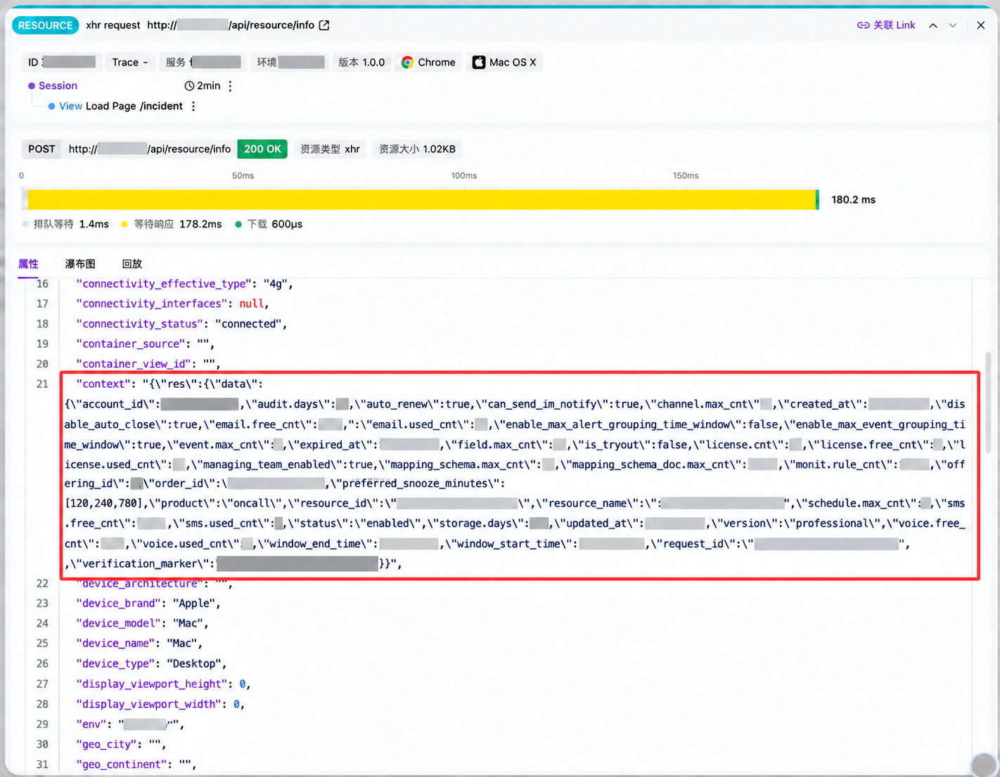

完成 [SDK 接入](/zh/rum/sdk/web/sdk-integration)后，按需配置视图、上下文、采样和分布式追踪。下方初始化示例可合并到您已有的 `flashcatRum.init()` 配置中。

## 覆盖默认 RUM 视图名称

RUM 在页面访问或 SPA URL 变化时自动创建视图，并将含数字的路径段归一化为 `?`。例如，`/dashboard/1234` 和 `/dashboard/9a` 的默认视图名称都是 `/dashboard/?`。需要手动划分路由视图时，启用手动视图跟踪；仅修改名称可使用 `setViewName()`。

### 配置手动跟踪视图

<Steps>
<Step title="启用手动跟踪">
在初始化时设置 `trackViewsManually` 为 `true`：

```javascript rum-init.js
import { flashcatRum } from "@flashcatcloud/browser-rum";

flashcatRum.init({
  applicationId: "<YOUR_APPLICATION_ID>",
  clientToken: "<YOUR_CLIENT_TOKEN>",
  trackViewsManually: true
});
```
</Step>

<Step title="调用 startView 方法">
在每个新页面或路由更改时调用 `startView` 方法：

```javascript
flashcatRum.startView({
  name: "checkout",
  service: "purchase",
  version: "1.2.3",
  context: {
    payment: "Done"
  }
});
```
</Step>
</Steps>

| `startView` 参数 | 说明 |
| --- | --- |
| `name` | 视图名称，默认为页面 URL 路径 |
| `service` | 服务名称，默认沿用应用的服务配置 |
| `version` | 应用版本，默认沿用应用的版本配置 |
| `context` | 附加到该视图及其子事件的上下文 |

### React Router 集成

<Accordion title="React Router v6 示例">

```javascript RumTracker.jsx
import { matchRoutes, useLocation } from "react-router-dom";
import { routes } from "path/to/routes";
import { flashcatRum } from "@flashcatcloud/browser-rum";
import { useEffect } from "react";

export default function App() {
  let location = useLocation();

  useEffect(() => {
    const routeMatches = matchRoutes(routes, location.pathname);
    const viewName = routeMatches && computeViewName(routeMatches);
    if (viewName) {
      flashcatRum.startView({ name: viewName });
    }
  }, [location.pathname]);

  // ...
}

function computeViewName(routeMatches) {
  let viewName = "";
  for (let index = 0; index < routeMatches.length; index++) {
    const routeMatch = routeMatches[index];
    const path = routeMatch.route.path;
    if (!path) continue;

    if (path.startsWith("/")) {
      viewName = path;
    } else {
      viewName += viewName.endsWith("/") ? path : `/${path}`;
    }
  }
  return viewName || "/";
}
```

</Accordion>

### 设置视图名称

使用 `setViewName` 方法更新当前视图的名称，而无需启动新视图：

```javascript
flashcatRum.setViewName("Checkout");
```

## 控制首屏 Web Vitals 采集

`trackWebVitals` 默认为 `true`，采集初始加载视图的 FCP、LCP、FID 和加载时间。对于预渲染、后台标签页或宿主提前加载的页面，这些指标可能偏大，可将此选项设为 `false`。资源、长任务、用户行为、错误和后续视图事件不受影响。

```javascript rum-init.js
import { flashcatRum } from "@flashcatcloud/browser-rum";

flashcatRum.init({
  applicationId: "<YOUR_APPLICATION_ID>",
  clientToken: "<YOUR_CLIENT_TOKEN>",
  trackWebVitals: false
});
```

## 丰富和控制 RUM 数据

使用 `beforeSend(event, context)` 在上报前添加上下文、修改允许的字段，或返回 `false` 丢弃事件。回调是同步的，不等待 Promise。

### 上下文类型

第二个参数 `context` 提供触发事件的浏览器对象：

| 事件类型 | 上下文 |
|----------|--------|
| View | `Location` 对象 |
| Action | 触发事件的 `Event` 和处理堆栈 |
| Resource (XHR) | `XMLHttpRequest`、`PerformanceResourceTiming` 和处理堆栈 |
| Resource (Fetch) | `Request`、`Response`、`PerformanceResourceTiming` 和处理堆栈 |
| Resource (Other) | `PerformanceResourceTiming` |
| Error | `Error` 对象 |
| Long Task | `PerformanceLongTaskTiming` |

### 丰富 RUM 事件

为事件添加上下文属性，例如为资源事件添加响应头数据：

```javascript
flashcatRum.init({
  applicationId: "<YOUR_APPLICATION_ID>",
  clientToken: "<YOUR_CLIENT_TOKEN>",
  beforeSend: (event, context) => {
    if (
      event.type === "resource" &&
      event.resource.type === "fetch" &&
      context.response
    ) {
      event.context = {
        ...event.context,
        responseHeaders: Object.fromEntries(context.response.headers),
      };
    }
    return true;
  }
});
```

<span id="resource-response-context"></span>
### 将接口响应体作为资源上下文上报（仅 XHR）

在 `beforeSend` 中读取 XHR 响应，将需要的字段写入 `event.context.res`。`res` 是自定义字段，SDK 不会自动采集响应体。

| 数据 | 支持范围 |
| --- | --- |
| XHR 的 JSON 或 JSON 文本响应体 | 可同步读取并附加到 `event.context`，示例见下文 |
| Fetch 的响应头、状态码和 URL | 可在 `context.response` 存在时同步读取；也可添加其他同步可用的业务字段 |
| Fetch 响应体、XHR Blob 响应 | 需要异步读取，不适用于此示例 |

`beforeSend` 不等待 Promise。在回调中调用 `await response.json()` 或 `await response.text()`，不会让 SDK 等待响应体解析完成。

<Steps>
<Step title="添加响应上下文">

按接口路径筛选请求。

```javascript
flashcatRum.init({
  applicationId: "<YOUR_APPLICATION_ID>",
  clientToken: "<YOUR_CLIENT_TOKEN>",
  trackResources: true,
  beforeSend(event, context) {
    if (event.type !== "resource" || event.resource.type !== "xhr") {
      return true;
    }
    if (new URL(event.resource.url).pathname !== "/api/orders/status") {
      return true;
    }
    const xhr = context.xhr;
    if (!xhr) return true;

    try {
      const res = xhr.responseType === "json"
        ? xhr.response
        : JSON.parse(xhr.responseText);
      event.context = { ...event.context, res };
    } catch {
      // 无法同步解析响应时，仍保留原资源事件。
    }
    return true;
  },
});
```

只采集必要的接口和字段，例如业务错误码和请求 ID。不要上报密码、访问令牌、会话凭据或个人信息。

</Step>
<Step title="查看上报结果">

<Frame caption="资源详情的 JSON 视图中显示 context，截图已脱敏。">
  
</Frame>

</Step>
</Steps>

**大小限制**

| 范围 | 限制与超限行为 |
| --- | --- |
| `beforeSend` 写回的整个 `event.context` | 默认序列化预算为 **225,280 个字符**（`220 × 1024`），按 JavaScript 字符串长度计算，包含字段名和 JSON 结构。超限时 SDK 停止复制后续字段或数组元素，并在控制台警告；超大字段可能整个缺失 |
| 整个事件 | 发送检查阈值为 **256 KiB**（`262,144`），按编码后的估算尺寸判断。达到或超过阈值时，SDK 丢弃整个事件并在控制台警告 |

`res` 与其他自定义字段共享 context 预算。字符数不等于 UTF-8 字节数；不要将 `256 KiB` 当作响应体额度，也不要依赖压缩扩大采集范围。


### 修改 RUM 事件内容

例如，从视图 URL 中屏蔽电子邮件地址：

```javascript
flashcatRum.init({
  applicationId: "<YOUR_APPLICATION_ID>",
  clientToken: "<YOUR_CLIENT_TOKEN>",
  beforeSend: (event) => {
    event.view.url = event.view.url.replace(/email=[^&]*/, "email=REDACTED");
  }
});
```

#### 可修改的属性

| 属性 | 说明 |
|------|------|
| `view.url` | 当前页面的 URL |
| `view.referrer` | 前一个页面的 URL |
| `view.name` | 当前视图名称 |
| `service` | 应用的服务名称 |
| `version` | 应用版本 |
| `action.target.name` | 用户交互的元素（仅限自动收集的操作） |
| `error.message` | 错误消息 |
| `error.stack` | 错误堆栈或补充信息 |
| `error.resource.url` | 触发错误的资源 URL |
| `resource.url` | 资源 URL |
| `context` | 通过上下文 API 或手动生成事件添加的属性 |

### 丢弃 RUM 事件

通过在 `beforeSend` 中返回 `false`，可以丢弃特定 RUM 事件：

```javascript
flashcatRum.init({
  applicationId: "<YOUR_APPLICATION_ID>",
  clientToken: "<YOUR_CLIENT_TOKEN>",
  beforeSend: (event) => {
    if (shouldDiscard(event)) {
      return false;
    }
  }
});
```

<Warning>
视图事件无法被丢弃。
</Warning>

## 用户会话

设置用户标识后，您可以在 RUM 中关联同一用户的会话和错误。

### 用户属性

以下属性均可选，建议至少设置一项：

| 事件字段 | 说明 |
| --- | --- |
| `usr.id` | 唯一用户标识符 |
| `usr.name` | 用户名称，优先用于界面显示 |
| `usr.email` | 用户邮箱，未设置名称时用于显示 |

### 用户会话 API

<Tabs>
<Tab title="设置用户">
```javascript
flashcatRum.setUser({
  id: "1234",
  name: "John Doe",
  email: "john@doe.com",
  plan: "premium"
});
```
</Tab>

<Tab title="获取用户">
```javascript
const user = flashcatRum.getUser();
```
</Tab>

<Tab title="更新属性">
```javascript
flashcatRum.setUserProperty("name", "John Doe");
```
</Tab>

<Tab title="删除属性">
```javascript
flashcatRum.removeUserProperty("name");
```
</Tab>

<Tab title="清除用户">
```javascript
flashcatRum.clearUser();
```
</Tab>
</Tabs>

<Note>
用户会话信息更改后，之后的 RUM 事件将包含更新后的信息。注销（调用 `clearUser`）后，最后一个视图仍保留用户信息，但后续视图和会话级别数据不会。
</Note>

## 采样

使用 `sessionSampleRate` 设置会话采样百分比，默认 `100`。例如，以下配置采集 90% 的会话：

```javascript
flashcatRum.init({
  applicationId: "<YOUR_APPLICATION_ID>",
  clientToken: "<YOUR_CLIENT_TOKEN>",
  sessionSampleRate: 90  // 采集 90% 的会话
});
```

<Warning>
未被普通采样抽中的会话默认不采集页面视图及其相关遥测数据；开启下方异常补采后，可在报错时补报。
</Warning>

### 异常会话补采

需要 Web SDK **0.3.0 及以上**。以下两个选项默认均为 `false`，只补采对应采样率未抽中的会话或回放。已抽中的会话保持正常采集。

| 参数 | 作用范围 | 首次报错后的行为 |
|------|----------|----------------|
| `sessionOnError` | `sessionSampleRate` 未抽中的会话 | 补报内存中最多最近一分钟的 RUM 事件，并继续正常采集上报 |
| `sessionReplayOnError` | 已采集会话中，`sessionReplaySampleRate` 未抽中回放的会话 | 补报内存中最多最近一分钟的回放，并继续正常录制上报 |

例如，保留 20% 的普通会话，并补采其余会话中的异常会话及回放：

```javascript
flashcatRum.init({
  applicationId: "<YOUR_APPLICATION_ID>",
  clientToken: "<YOUR_CLIENT_TOKEN>",
  sessionSampleRate: 20,
  sessionReplaySampleRate: 0,
  sessionOnError: true,
  sessionReplayOnError: true
});
```

- 未抽中的候选数据先缓存在内存中，首次符合条件的错误触发补报。最多回溯一分钟，不保证完整保留，也无法恢复 SDK 初始化或录制开始前的数据。
- 只有 RUM 错误事件触发补采，例如 JavaScript 错误或 `addError()`。被 `beforeSend` 丢弃、被限流或 SDK 自身的错误不触发；失败请求和 HTTP 5xx 资源事件也不触发。
- `sessionOnError` 候选会话始终未报错时，事件和回放不上传、不计费。仅开启 `sessionReplayOnError` 时，无错误的候选回放不上传、不计费；普通采样已抽中的 RUM 会话仍正常上报和计费。
- 同一会话只计一次，不因重复报错重复计数。异常补采会话按实际数量统计，不按 `1 / sessionSampleRate` 放大。

<Note>
`sessionSampleRate: 100` 时，`sessionOnError` 没有额外作用；`sessionReplaySampleRate: 100` 时，`sessionReplayOnError` 没有额外作用。`sessionSampleRate: 0` 且未开启 `sessionOnError` 时，仅开启 `sessionReplayOnError` 也不会采集任何会话。若只想保留异常会话及回放，可将两个采样率都设为 `0`，同时开启两个补采开关。
</Note>

#### 已知限制

| 场景 | 行为或建议 |
| --- | --- |
| 单页应用 | 回放仅回溯到当前视图起点，最多一分钟；RUM 事件可跨视图回溯最多一分钟 |
| 报错后立即关闭或跳转页面 | 较大的补报数据（约超过 64 KiB）可能因浏览器退出时的发送上限丢失，压缩不能保证送达。SDK 优先发送视图和错误，可能丢失较早的其他事件及最后一次视图更新 |
| 复杂且频繁更新的页面 | 缓存回放会增加主线程开销，并可能缩短回溯范围。此类页面建议仅开启 `sessionOnError` |
| 手动开始回放录制 | 显式设置 `startSessionReplayRecordingManually: true`。即使初始化回放采样率为 `0`，远程配置也可能使录制自动开始；不要用采样率代替用户同意。手动开始前的操作不能补采 |
| 报错后撤回跟踪同意 | 已触发补报、在同意期间采集的候选数据仍会上传 |

两个开关也可以通过[远程配置](/zh/rum/quickstart/app-management#远程配置)调整。

## 远程配置

需要 Web SDK **0.4.0 及以上**。设置 `remoteConfigurationEnabled: true`（默认 `false`），可使用控制台发布的采样、回放、隐私和自定义配置覆盖初始化值。新配置对下一个新会话生效，支持项与发布步骤见[应用管理](/zh/rum/quickstart/app-management#远程配置)。

```javascript
flashcatRum.init({
  // ... 其他配置
  remoteConfigurationEnabled: true
});
```

## 用户跟踪同意

需要先获得用户同意时，将 `trackingConsent` 初始化为 `"not-granted"`，同意后调用 `setTrackingConsent("granted")`：

| 状态 | 行为 |
|------|------|
| `"granted"` | 开始收集数据并发送到 Flashduty |
| `"not-granted"` | 不收集任何数据 |

### 示例：处理用户同意

```javascript
flashcatRum.init({
  applicationId: "<YOUR_APPLICATION_ID>",
  clientToken: "<YOUR_CLIENT_TOKEN>",
  trackingConsent: "not-granted"
});

acceptCookieBannerButton.addEventListener("click", function () {
  flashcatRum.setTrackingConsent("granted");
});
```

<Note>
同意状态不会在标签页间同步或持久化，您需要在初始化或通过 `setTrackingConsent` 提供用户决定。
</Note>

## 视图上下文

您可以通过以下 API 为当前视图及其子事件添加或修改上下文：

<Tabs>
<Tab title="启动视图时指定">
```javascript
flashcatRum.startView({
  name: "checkout",
  context: {
    hasPaid: true,
    amount: 23.42
  }
});
```
</Tab>

<Tab title="添加/修改属性">
```javascript
flashcatRum.setViewContextProperty("activity", {
  hasPaid: true,
  amount: 23.42
});
```
</Tab>

<Tab title="替换上下文">
```javascript
flashcatRum.setViewContext({
  originalUrl: "shopist.io/department/chairs"
});
```
</Tab>
</Tabs>

## 错误上下文

在捕获错误时，您可以通过 `dd_context` 属性为错误对象附加本地上下文：

```javascript
const error = new Error("Something went wrong");
error.dd_context = { component: "Menu", param: 123 };
throw error;
```

## 全局上下文

全局上下文会附加到所有 RUM 事件上：

```javascript
// 添加属性
flashcatRum.setGlobalContextProperty("activity", {
  hasPaid: true,
  amount: 23.42
});

// 删除属性
flashcatRum.removeGlobalContextProperty("codeVersion");

// 替换全局上下文
flashcatRum.setGlobalContext({
  codeVersion: 34
});

// 清除全局上下文
flashcatRum.clearGlobalContext();

// 读取全局上下文
const context = flashcatRum.getGlobalContext();
```

### 上下文生命周期

全局上下文和用户信息默认不跨页面刷新保留，也不在标签页间共享。设置 `storeContextsAcrossPages: true` 可将其保存到 `localStorage`：

```javascript
flashcatRum.init({
  applicationId: "<YOUR_APPLICATION_ID>",
  clientToken: "<YOUR_CLIENT_TOKEN>",
  storeContextsAcrossPages: true
});
```

<Warning>
- 不建议在上下文中存储个人身份信息，因为 `localStorage` 数据会超出用户会话生命周期
- 与 `trackSessionAcrossSubdomains` 选项不兼容
- `localStorage` 容量限制为 5 MiB
</Warning>

## 微前端支持

在 `beforeSend` 中按事件的调用堆栈设置 `service` 和 `version`，区分微前端应用：

```javascript
const SERVICE_REGEX = /some-pathname\/(?<service>\w+)\/(?<version>\w+)\//;

flashcatRum.init({
  applicationId: "<YOUR_APPLICATION_ID>",
  clientToken: "<YOUR_CLIENT_TOKEN>",
  beforeSend: (event, context) => {
    const stack = context?.handlingStack || event?.error?.stack;
    const { service, version } = stack?.match(SERVICE_REGEX)?.groups || {};

    if (service && version) {
      event.service = service;
      event.version = version;
    }

    return true;
  }
});
```

<Note>
以下事件无法归因于特定来源：自动收集的操作事件、非 XHR/Fetch 的资源事件、视图事件、CORS 和 CSP 违规事件。
</Note>

## 集成 RUM 与分布式追踪

配置 `allowedTracingUrls`，为匹配的 API 请求注入追踪头，以关联浏览器请求和后端 Trace。

### 使用方法

使用 `allowedTracingUrls` 参数配置当前应用的 API 服务域名：

```javascript
import { flashcatRum } from "@flashcatcloud/browser-rum";

flashcatRum.init({
  applicationId: "<YOUR_APPLICATION_ID>",
  clientToken: "<YOUR_CLIENT_TOKEN>",
  service: "<SERVICE_NAME>",
  env: "<ENV_NAME>",
  version: "1.0.0",
  sessionSampleRate: 100,
  allowedTracingUrls: [
    "https://api.example.com",
    /https:\/\/.*\.my-api-domain\.com/,
    (url) => url.startsWith("https://api.example.com")
  ],
  traceSampleRate: 20
});
```

CDN 接入使用相同的初始化参数，加载方式见 [SDK 接入指南](/zh/rum/sdk/web/sdk-integration)。

`allowedTracingUrls` 匹配完整 URL，接受以下类型：

| 类型 | 说明 |
|------|------|
| **String** | 匹配任何以该值开头的 URL |
| **RegExp** | 使用正则表达式的 `test()` 方法检查匹配 |
| **Function** | 接收 URL 作为参数，返回 `true` 表示匹配 |

### 追踪协议

SDK 在匹配的请求上添加 `traceparent` 和 `tracestate` 请求头，字段含义与示例见 [分布式追踪](/zh/rum/best-practices/distributed-tracing#追踪头信息说明)。

### 如何验证

在浏览器 Network 面板检查匹配请求是否携带 `traceparent` 和 `tracestate` 追踪头。

<Frame>

</Frame>

<Warning>
如您的 HTTP 请求涉及到跨域问题，需要确保请求可通过跨域检测。请确保对应的 server [有跨域相关配置](https://developer.mozilla.org/en-US/docs/Web/HTTP/Reference/Headers/Access-Control-Allow-Headers)，支持[预检请求](https://developer.mozilla.org/en-US/docs/Glossary/Preflight_request)访问。
</Warning>

<span id="注意事项"></span>

## 相关文档

<CardGroup cols={3}>
<Card title="SDK 接入指南" icon="plug" href="/zh/rum/sdk/web/sdk-integration">
  了解如何快速接入 RUM SDK
</Card>
<Card title="数据收集" icon="database" href="/zh/rum/sdk/web/data-collection">
  了解 SDK 收集的数据类型和属性
</Card>
<Card title="问题排查" icon="bug" href="/zh/rum/sdk/web/faq">
  解决常见问题和调试技巧
</Card>
</CardGroup>

SDK 源码与版本见 [Flashduty SDK GitHub 仓库](https://github.com/flashcatcloud/browser-sdk)。
